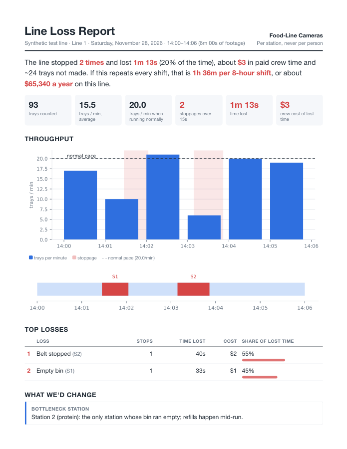

# foodline: Line Loss Report MVP

Overhead camera footage of a food assembly line in, a **Line Loss Report** out:
trays per minute, every stoppage with what it cost, the top losses, and what to change.

This is **Phase 0**: it runs on a laptop, uses no trained model yet, and counts
trays at one camera over the end of the line. Phase 1 adds a trained tray
detector, people per station and bottleneck ranking.



## How it works

```
video files ──► count trays crossing a line ──► gaps between trays ──► you tag causes ──► report.html / .pdf
               (background subtraction           (> 2× normal cycle     (stoppages.csv)
                + blob tracking, belt zone only)   and ≥ 15 s)
```

- **Throughput:** trays crossing the red count line, per minute and per hour.
- **Stoppage:** a gap between finished trays longer than 2× the normal cycle (never under 15 s).
  Lost time = the gap minus one normal cycle.
- **Cost:** lost minutes × crew size × loaded $/hr (set per plant in the config).
- **Causes:** the software finds the stops and a person names the cause. The report only
  shows causes someone confirmed.
- **Touching trays:** a blob about twice the normal tray size counts as 2.

On the synthetic test line it counts **93/93 trays** (±0%), finds both staged stoppages
(an empty bin and a belt stop), and ignores a normal 9-second gap.

## Setup (macOS)

```bash
# Keep the virtualenv OUT of iCloud-synced folders (Desktop/Documents): iCloud makes imports hang.
python3.11 -m venv ~/.venvs/foodline
~/.venvs/foodline/bin/pip install -r requirements.txt
alias fl="~/.venvs/foodline/bin/python run.py"
```

## Try it on the synthetic line (no camera needed)

```bash
~/.venvs/foodline/bin/python tools/make_synthetic.py                 # ~2 min, writes footage/synthetic/
fl calibrate configs/synthetic.yaml --line 0.82,0.33,0.82,0.67 --zone 0,0.347,1,0.347,1,0.653,0,0.653
fl all configs/synthetic.yaml --debug-video                           # count + report
fl evaluate configs/synthetic.yaml --truth footage/synthetic/truth.csv
open runs/synthetic/2026-11-28/report.pdf
```

## Run it on the mock line

1. **Film** (see the guide below), then put the video in `footage/mock/`.
2. **Calibrate:** `fl calibrate configs/mock.yaml`. Click 2 points for the count line,
   then click around the belt/table area and press Enter.
3. **Process:** `fl process configs/mock.yaml --start "2026-11-28 14:00:00" --debug-video`.
   Watch `runs/mock/<day>/debug_cam3.mp4` to see what was counted.
4. **Review:** open `runs/mock/<day>/stoppages.csv` and fill in `cause`
   (empty bin, short-staffed, jam, belt stopped, changeover, quality check, break, other).
   Thumbnails are in `thumbs/`. Optionally fill in `notes.yaml` (bottleneck, recommended change).
5. **Report:** `fl report configs/mock.yaml` writes `report.html` and `report.pdf`
   (PDF via headless Chrome).
6. **Check accuracy:** `fl handcount configs/mock.yaml --minutes 10` (press space each time
   a tray crosses the line), then `fl evaluate configs/mock.yaml`. The target is ±2%.
   The result is printed in the report.

### Filming the mock line (phone, ~20 min)

- **Overhead, steady:** tape or clamp the phone 6–8 ft above the end of the table,
  looking down. Landscape, 1080p, 30 fps. No hand-holding.
- **Count zone past the last station:** the last 2–3 ft of table should have only trays
  moving through it, with no hands. Slide each finished tray through that zone in one direction.
- **Contrast:** dark trays on a light tablecloth, or the other way round. Even light, no
  window in frame.
- **3 stations, 3–4 people, one tray every 3–5 s.** Stage at least two stoppages and write
  down the times: an empty "ingredient bin" (~30 s), a missing person (~45 s), and one
  "changeover" (switch tray type, ~2 min).
- **Note the time you hit record**, and pass it as `--start`.

## Config

`configs/<name>.yaml`: plant, line, crew size, $/hr, cameras and footage paths, stoppage
thresholds. All defaults are in [`foodline/config.py`](foodline/config.py).
Calibration lives in `configs/<name>.calib.yaml` (0..1 coordinates), written by `calibrate`.

Recorder files named like `cam3_20261222_060000.mp4` (from the Pilot Kit's `record.sh`)
are timestamped automatically. A folder of 15-minute segments becomes one timeline, and
gaps in the footage are never counted as stoppages.

## Privacy

- **Never commit footage, runs or calibration snapshots.** `.gitignore` blocks
  `footage/`, `runs/` and `configs/*.calib.jpg`. This repository is public.
- Every image in a report is blurred outside the belt zone. If an OpenCV YuNet model is placed at
  `models/face_detection_yunet.onnx`, faces inside the zone are blurred too.
- Results are per line and per station, never per person. Only trays are tracked, and no identities are stored.
- Keep real plant footage on an encrypted drive, not in iCloud or Dropbox.

## Layout

```
run.py                     CLI: calibrate | process | report | all | handcount | evaluate
foodline/ingest.py         video files → timeline (filename / metadata / --start)
foodline/calibrate.py      click tool for count line + belt zone
foodline/count.py          v0 counter: MOG2 background subtraction + tracking + line crossing
foodline/events.py         trays → per-minute counts, stoppages, lost time, $
foodline/blur.py           privacy blur for exported frames
foodline/handcount.py      hand-count player + accuracy check
foodline/report/           HTML template + charts + PDF export
tools/make_synthetic.py    synthetic line with ground truth
tests/                     unit tests (pytest)
```

## Known limits (fixed in Phase 1)

- The v0 counter counts *anything* moving across the line inside the belt zone. Keep hands out
  of the count zone. A textured moving belt can confuse it, which the trained detector fixes.
- Causes are tagged by hand. Belt-stopped vs. starved detection, people per station and
  bottleneck ranking come in Phase 1.
- Speed: about 1 minute to process 6 minutes of 720p video on an M3 laptop. Phase 2 target: one
  shift (3 cameras × 8 h) in under 2 h.
